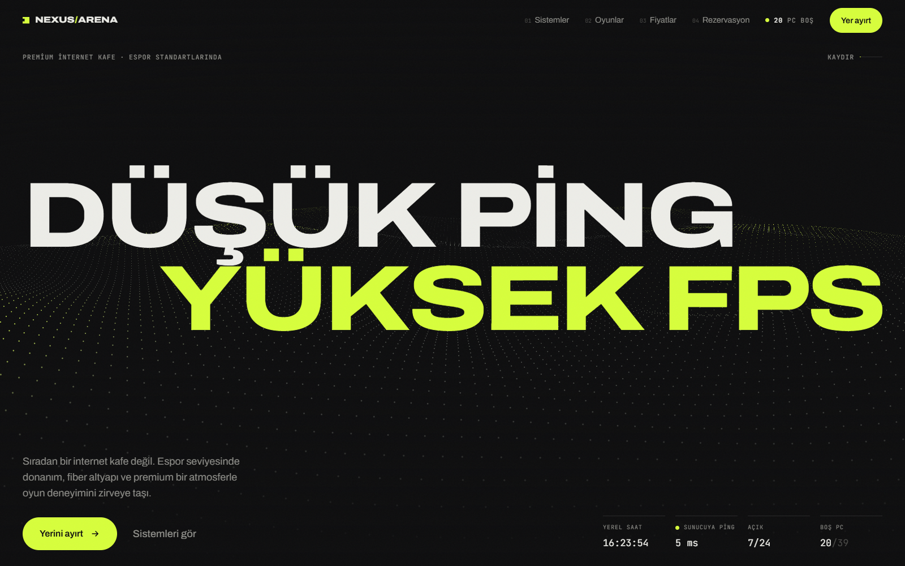
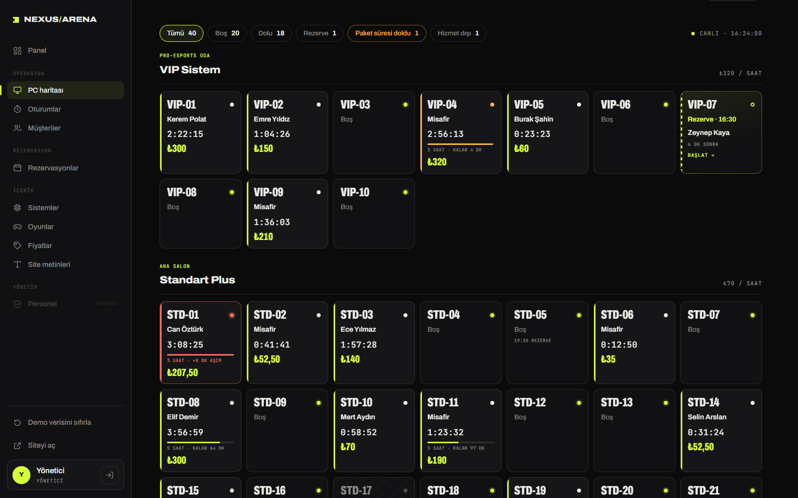

# Nexus Arena

> İnternet Kafe Web Sitesi & Yönetim Paneli

Premium internet kafeler için sinematik bir tanıtım sitesi ve ona bağlı yönetim paneli. Site; donanım sınıflarını, yüklü oyunları ve fiyatları anlatır, canlı boş PC durumu ve onaya düşen online rezervasyon içerir. Panelde canlı PC haritası, oturum ve ücret takibi, müşteri bakiyeleri, rezervasyon onayı, gün sonu kasası ve site içeriği yönetilir.

**Site:** https://serkangudur.com/projeler/nexus-arena · **Panel:** https://serkangudur.com/projeler/nexus-arena-panel





> [!NOTE]
> Asıl uygulama ASP.NET Core + Blazor Server + SQLite ile çalışır. Bu repo, aynı kuralları (ücret hesabı, rezervasyon politikası, bakiye defteri) tarayıcıda uygulayan statik demo sürümüdür: veriler localStorage'da tutulur, site ve panel aynı veriyi paylaşır, açık sekmeler birbirinin değişikliğini anında görür.

## Öne çıkanlar

- Sinematik tanıtım sitesi (GSAP SplitText + ScrollTrigger)
- Canlı boş PC durumu ve online rezervasyon
- Yönetim paneli: PC haritası, oturumlar, müşteriler, bakiyeler
- Gün sonu kasası ve site içeriği yönetimi
- ES modülleriyle düzenlenmiş kod, sekmeler arası anlık senkron

## Teknolojiler

`HTML5` · `CSS3` · `JavaScript (ES Modules)` · `GSAP` · `Lenis` · `ASP.NET Core / Blazor (asıl sürüm)`

## Yerelde çalıştırma

Derleme adımı yoktur; herhangi bir statik sunucu yeterlidir:

```bash
npx serve .
```

ES modülleri kullanıldığı için dosyayı doğrudan çift tıklayarak değil, bir sunucu üzerinden açın.

---

Bu proje [serkangudur.com](https://serkangudur.com) portfolyosunun bir parçasıdır. Sayfadaki iletişim bilgileri örnek amaçlıdır.
